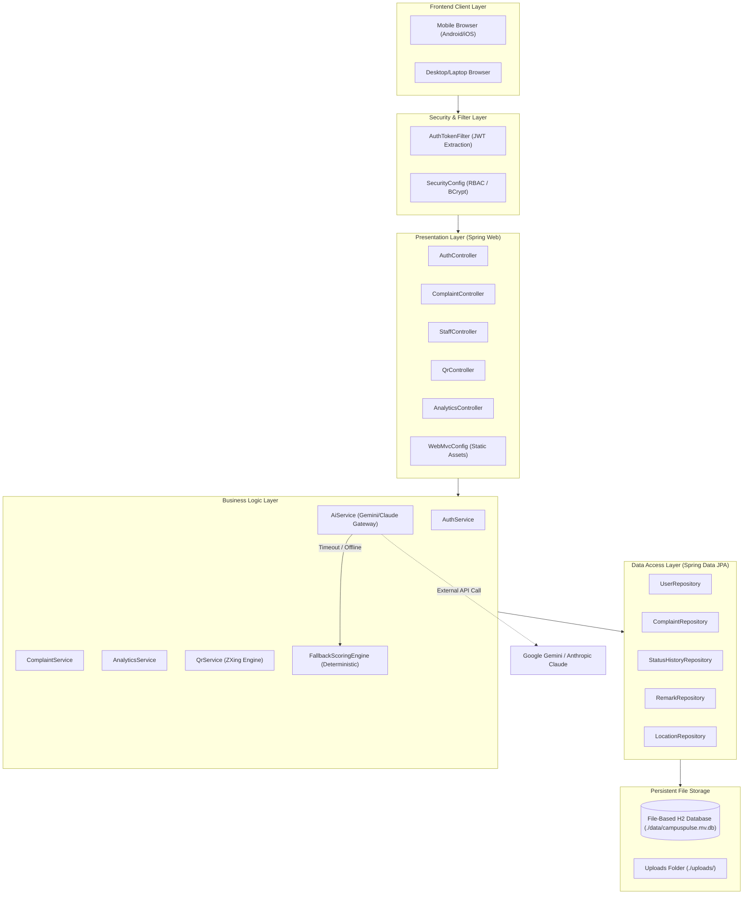
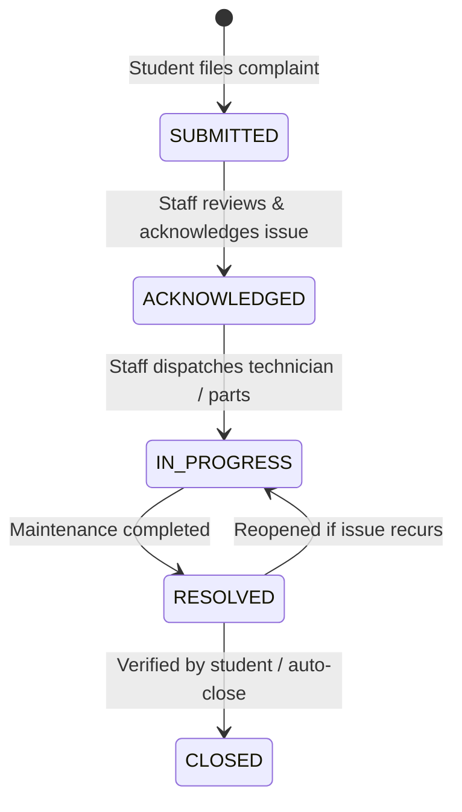

# CampusPulse — System Architecture

## 1. High-Level Architecture Overview

CampusPulse is built as a modular monolithic web application powered by **Spring Boot 3.3.5** running on **Oracle JDK 25**. The architecture follows a strict layered separation of concerns:

---

## 2. Complaint Submission & Prioritization Flow

```mermaid
sequenceDiagram
    autonumber
    actor Student as Student (Browser/Camera)
    participant Auth as Spring Security (JWT)
    participant CC as ComplaintController
    participant CS as ComplaintService
    participant AI as AiService / FallbackEngine
    participant DB as File-based H2 Database

    Student->>Auth: POST /api/complaints/submit (Bearer Token + Form Data)
    Auth->>CC: Authorized Student User
    CC->>CS: submitComplaint(req, photo, student)
    
    rect rgb(20, 35, 65)
        Note over CS,AI: Intelligent Prioritization
        CS->>AI: analyzeComplaint(title, desc, category, location, severity)
        alt Gemini/Claude API configured & available
            AI->>AI: Call Generative API (Timeout 3.5s)
        else Offline / No Key / Timeout
            AI->>AI: Run FallbackScoringEngine (Hazard Keyword & Rule Analysis)
        end
        AI-->>CS: AiAnalysisResult (score, priority, department, factors)
    end

    CS->>DB: Save Complaint (CP-100X, status: SUBMITTED)
    CS->>DB: Record initial StatusHistory ("SUBMITTED")
    CS-->>CC: ComplaintResponse
    CC-->>Student: 200 OK (Ticket ID: CP-100X, Priority: High)
```

---

## 3. Status Lifecycle & Transition Rules

Complaints follow a strict forward-progressing lifecycle:

Every transition automatically captures:
- Previous status
- New status
- Acting staff member
- Optional staff remarks
- Exact timestamp
