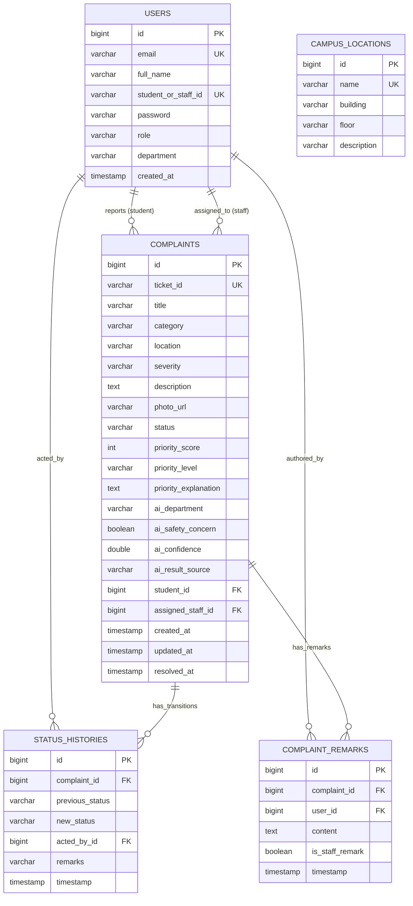

# CampusPulse — Database Design & Schema Specification

CampusPulse utilizes a **persistent file-based H2 database** stored at:
```
backend/data/campuspulse.mv.db
```

The database configuration in `application.properties`:
```properties
spring.datasource.url=jdbc:h2:file:./data/campuspulse;DB_CLOSE_DELAY=-1;AUTO_SERVER=TRUE
spring.jpa.hibernate.ddl-auto=update
```
This guarantees that records survive context restarts, system reboots, and redeployments without data loss.

---

## 1. Entity-Relationship (ER) Diagram



---

## 2. Table Specifications & Constraints

### 1. `users`
- `id`: Auto-incrementing primary key.
- `email`: College email address (Unique, not null).
- `student_or_staff_id`: Unique institutional identifier (e.g. `STU-2024-001`, `STF-201`).
- `password`: BCrypt hashed hash (never plaintext).
- `role`: Enum string (`ROLE_STUDENT`, `ROLE_STAFF`, `ROLE_ADMIN`).

### 2. `complaints`
- `ticket_id`: Unique public reference (e.g. `CP-1005`), indexed for high-performance lookup.
- `category`: Category enum (`ELECTRICAL`, `PLUMBING`, `CLEANLINESS`, `INFRASTRUCTURE`, `INTERNET`, `SAFETY`, `LABORATORY_EQUIPMENT`, `CLASSROOM_EQUIPMENT`, `OTHER`).
- `severity`: User-selected severity (`LOW`, `MEDIUM`, `HIGH`, `CRITICAL`).
- `priority_score`: Integer (0–100) computed by AI or local fallback engine.
- `priority_explanation`: Plain-text breakdown of scoring factors (e.g., `High severity selected (+30 pts) | Hazard keyword 'sparks' (+35 pts)`).
- `ai_result_source`: Tracks whether score originated from `FALLBACK_ENGINE`, `AI_GEMINI`, or `AI_CLAUDE`.

### 3. `status_histories`
- Captures an immutable audit log of every status transition.
- Linked to `complaint_id` and the acting staff/student user `acted_by_id`.

### 4. `complaint_remarks`
- Interactive comments and updates between students and maintenance staff.
- Includes `is_staff_remark` flag to style remarks appropriately in the frontend thread.

### 5. `campus_locations`
- Stores predefined physical campus locations (e.g. `Lab-1`, `Lab-2`, `Library`, `Block-A`, `Block-B`, `Classroom`, `Canteen`, `Washroom`).
- Used for ZXing QR code generation and form dropdown preselection.
